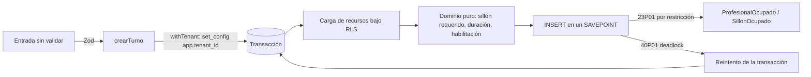

# turnos-odontologia

SaaS multi-tenant de turnos para consultorios odontológicos. Este repositorio contiene por ahora el núcleo de la agenda: crear y cancelar turnos sin solapamientos por profesional ni por sillón/box, garantizado por PostgreSQL, con aislamiento entre consultorios por Row Level Security.

La documentación del dominio está en [`knowledge-base/`](knowledge-base/README.md) y el plan de implementación en [`CHANGES.md`](CHANGES.md).

## Prerrequisitos

| Herramienta | Versión | Verificar |
|-------------|---------|-----------|
| Node.js | 22.18 o superior (ejecuta TypeScript sin compilar) | `node --version` |
| pnpm | 12 (fijado en `packageManager`) | `pnpm --version` |
| PostgreSQL | 16 o superior, con la extensión `btree_gist` (viene en contrib) | `psql --version` |

En Windows, agregá `C:\Program Files\PostgreSQL\<versión>\bin` al `PATH` para usar `psql`.

## Variables de entorno

Copiá `.env.example` a `.env` y completá las claves. `.env` está en `.gitignore` y **nunca se commitea**.

| Variable | Usuario | Base | Para qué |
|----------|---------|------|----------|
| `DATABASE_URL` | rol de la app (ej. `turnos_app`) | `turnos` | La aplicación. Sin `BYPASSRLS`, sujeta a RLS. |
| `DATABASE_URL_MIGRACIONES` | `postgres` (o un rol con permiso para crear bases y roles) | `turnos` | Migraciones y seed. |
| `DATABASE_URL_TEST` | rol de la app | `turnos_test` | Tests de integración (operaciones bajo prueba). |
| `DATABASE_URL_TEST_MIGRACIONES` | `postgres` | `turnos_test` | Tests de integración (preparar la base y los datos). |

El rol de la app no hace falta crearlo a mano: `pnpm db:migrate` lo crea (o le actualiza la clave) con el usuario y la clave de `DATABASE_URL`, y lo hace miembro del grupo `app_user`. El usuario de la app tiene que ser distinto del de migraciones.

Las bases de test deben terminar en `_test`: la suite la borra y la vuelve a crear en cada corrida.

## Puesta en marcha

```sh
pnpm install
pnpm db:migrate   # crea la base si falta, aplica db/migrations y asegura el rol de la app
pnpm db:seed      # carga el consultorio Demo con datos ficticios (idempotente)
```

## Tests y verificaciones

```sh
pnpm typecheck
pnpm lint
pnpm test:unit          # dominio y zona horaria, sin base de datos
pnpm test:integration   # PostgreSQL real: RLS, exclusiones, casos de uso y concurrencia
pnpm test               # ambos
```

Los tests de integración no mockean la base. Recrean `turnos_test`, aplican las migraciones y cada test crea sus propios consultorios ficticios con UUID nuevos. CI (`.github/workflows/ci.yml`) corre lo mismo contra un servicio `postgres:16`.

## Cómo se garantiza que no haya solapamientos



- `turno_sin_solapamiento_profesional` y `turno_sin_solapamiento_sillon` son restricciones `EXCLUDE USING gist` sobre `tstzrange [inicio, fin)` y solo cuentan los estados activos (`reservado`, `atendido`, `ausente`). Los turnos contiguos no chocan y los cancelados liberan el horario.
- La aplicación no consulta antes de insertar: la base decide, también ante inserciones simultáneas.

## Estructura

```
src/shared/      config, db (cliente, esquema, withTenant), time (zona del consultorio <-> UTC)
src/features/agenda/
  domain/        reglas puras, sin Drizzle ni driver
  application/   casos de uso crearTurno y cancelarTurno, puertos
  infrastructure/repositorio Drizzle
db/              migraciones, herramientas de migración, seed y datos demo
tests/           unit/ e integration/
```

## Datos

Nunca uses datos reales de pacientes en el repositorio, en los tests ni en ejemplos. No se debe desplegar ni cargar datos reales hasta resolver las preguntas PA-01 a PA-05 de [`knowledge-base/10_preguntas_abiertas.md`](knowledge-base/10_preguntas_abiertas.md).
